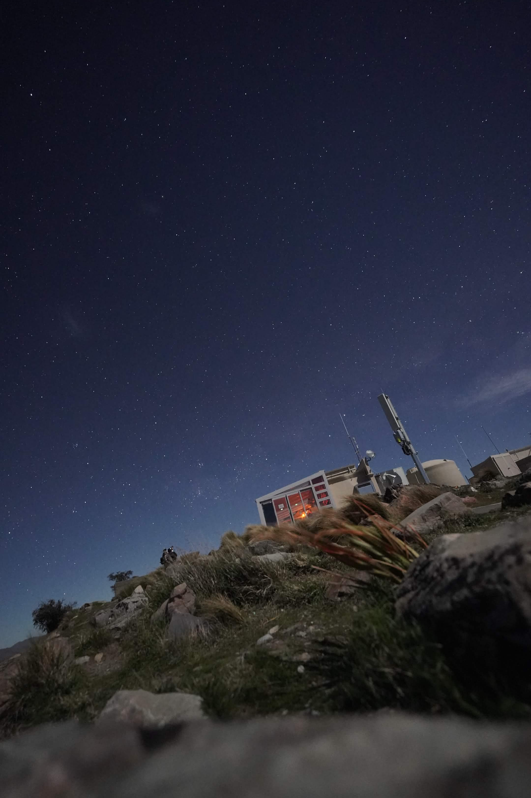
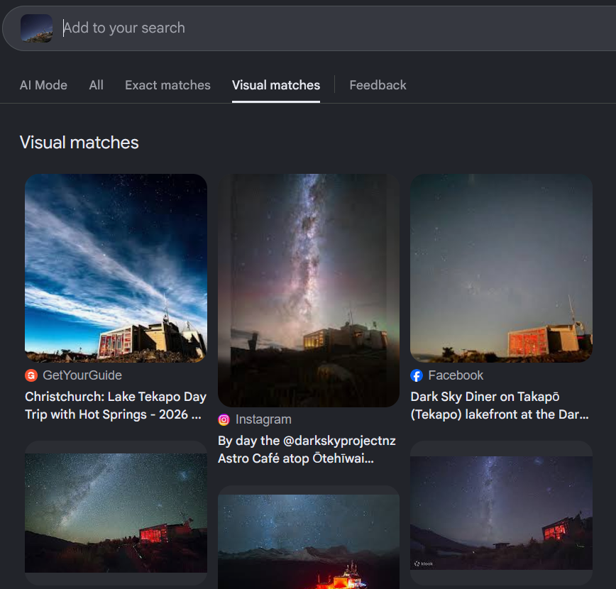
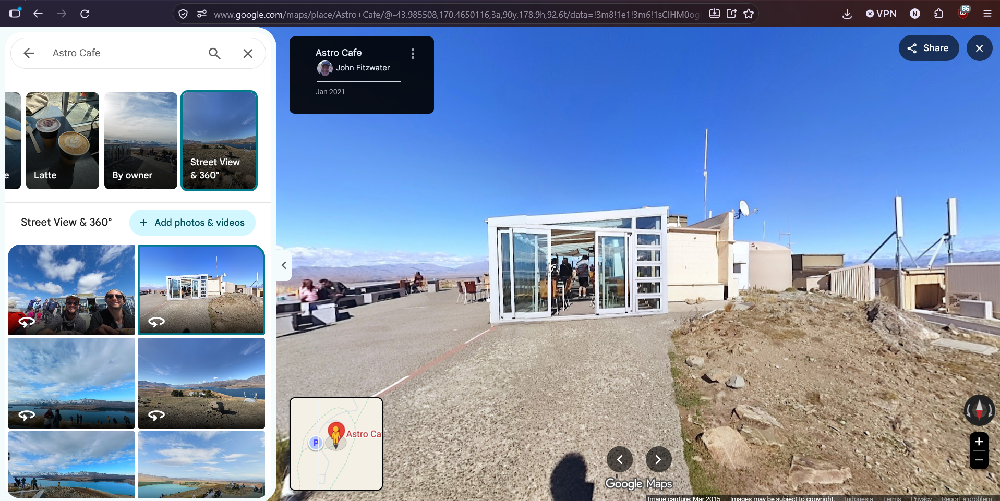
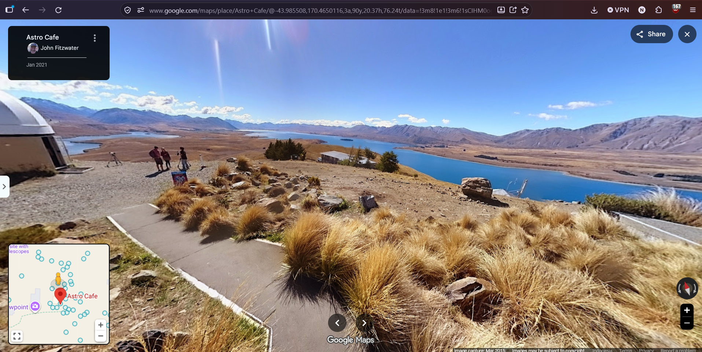
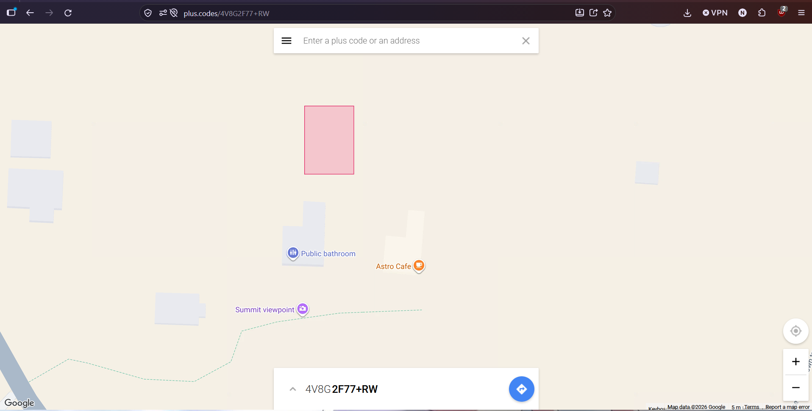

# [Will be there OSINT?]

- **CTF Name:** HITCON 2026
- **Category:** OSINT
- **Writeup Author:** Nakata Christian (n4ct) - TCP1P
- **Date:** October 24, 2026

---

## Challenge Description

> "Will be there OSINT?"
> Simple Ans: Sure!
> Sorry, I was travelling and couldn't provide additional interesting challenges. But and OSINT challenge should be manageable!
>
> Submit the location's full Plus Code in uppercase.
> Flag format: hitcon{XXXXXXXX+XX}

---

### Step 1: Initial Triage

We're given an image showing a building on a hill with a starry sky in the background.

Let's do a reverse image search on it.

Here, we got a bunch of `Lake Tekapo` and `Astro Cafe`.

### Step 2: Examine Astro Cafe

If we search `Astro Cafe Lake Tekapo` on Google Maps and check the 360 Street View, we can see the exact same building. So we can confirm that the building from the challenge is indeed `Astro Cafe` in `Lake Tekapo, New Zealand`.

### Step 3: Get the Full Plus Code

Once we get the location, we can go to `https://plus.codes/map` to get the full Plus Code. First, we need to find the exact spot where the photo was taken. From the original photo, we can see it was taken a bit in front of the cafe around this area (looking back from the 360 view earlier).

After a few tries, I got the correct Plus Code which is `4V8G2F77+RW`.

Flag: `hitcon{4V8G2F77+RW}`

Note: Watch out for the starry sky rabbit hole. Some might go straight to searching for the constellation or exact stars, so remember to always do a reverse image search first.