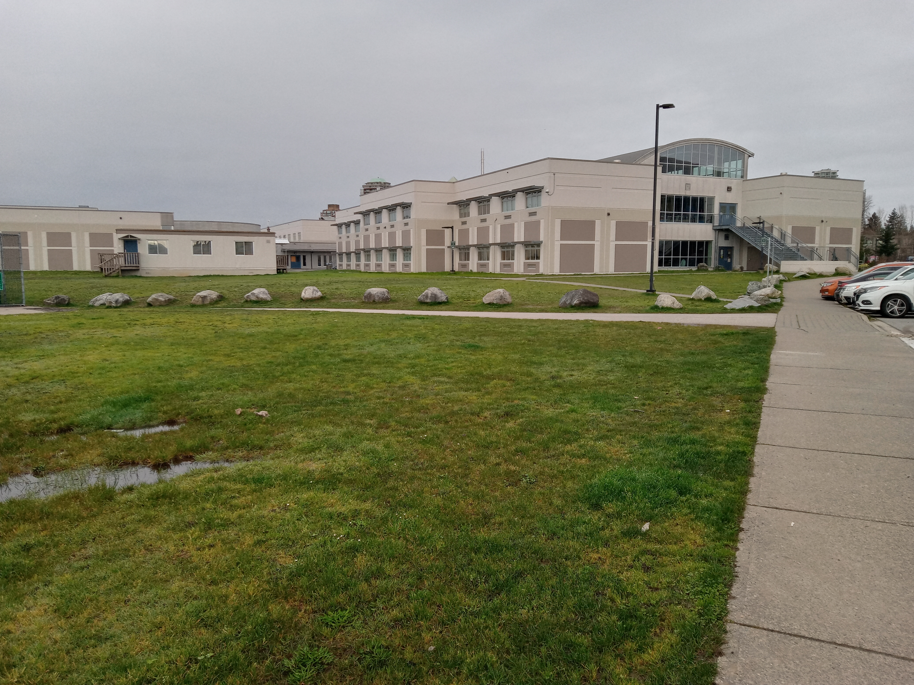
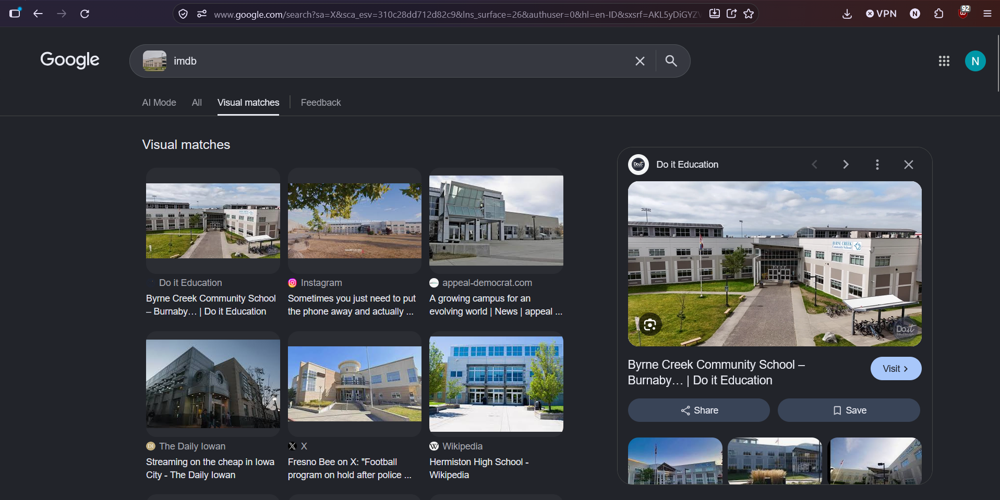
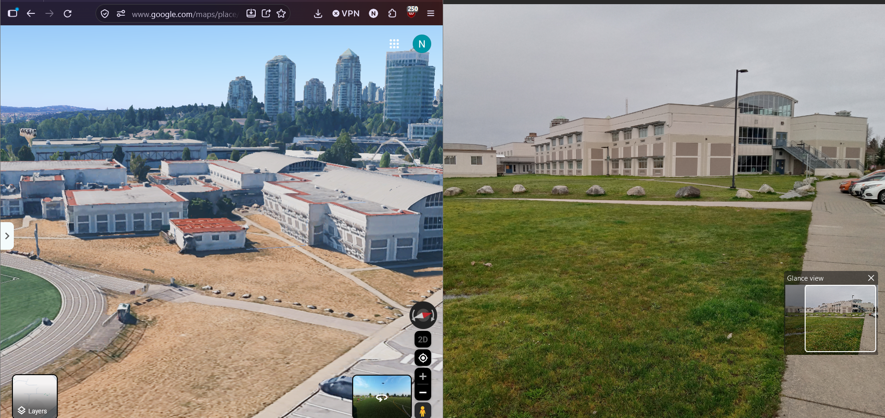
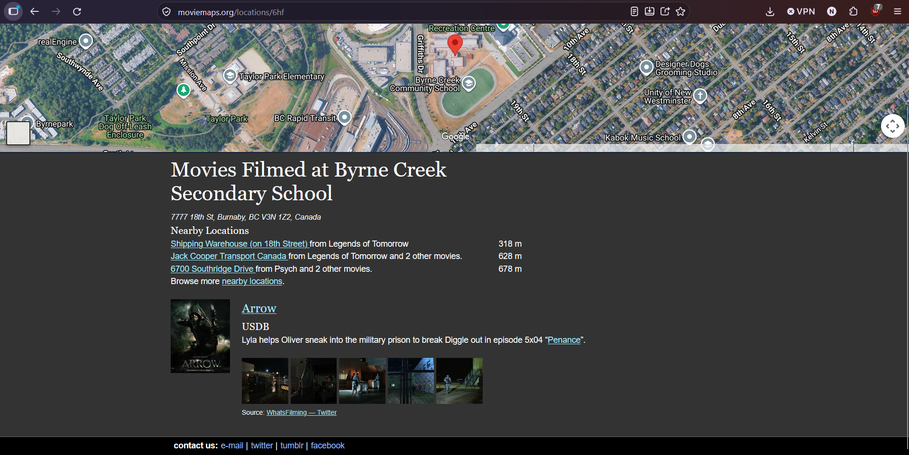

# [Moving Picture]

- **CTF Name:** Platypwn 2026
- **Category:** OSINT
- **Writeup Author:** Nakata Christian (n4ct) - TCP1P
- **Date:** November 14, 2026

---

## Challenge Description

> The other day they were filming something around this building. I'm curious what it was. Can you find the IMDB id of the motion picture?

---

### Step 1: Initial Triage

We're given a photo featuring a building that looks like a school. Let's do a reverse image search on this photo.

If we add `imdb` to the search bar, we'll find `Byrne Creek Community School` that looks similar to our original pic and we can even see the curvy roof. But first, we need to make sure whether this is indeed the right building using Google Maps 3D.

And yep this is the right building. Next, we need to find the IMDB id of the motion picture filmed here.

### Step 2: What Movie?

Once we get the location, we can go to Google and search `byrne creek community school film`. Scroll a bit and we'll find a website named `MovieMaps` and voila we got the film which is `Arrow`.

Next, go to IMDB, search for `Arrow` and look at the URL for the id `tt2193021`. Submit this id to the id checker for this challenge and we'll get the flag.

Flag: `Unfortunately, I forgot to copy the flag to my notepad and also forgot to take a screenshot when I solved this challenge`