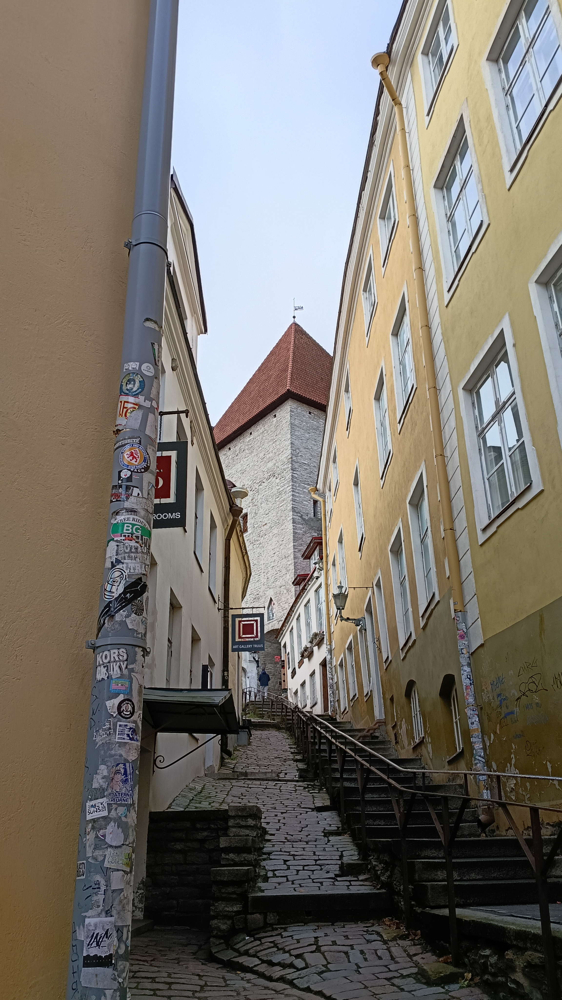
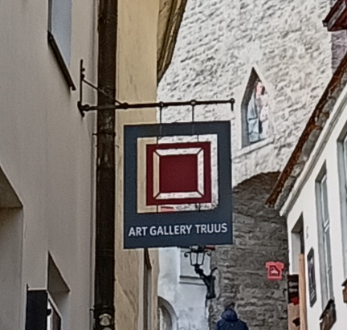
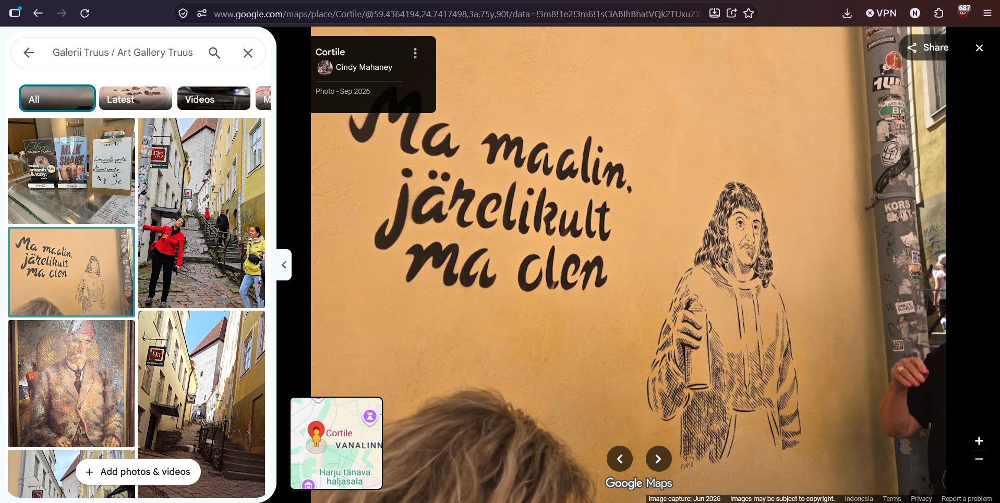
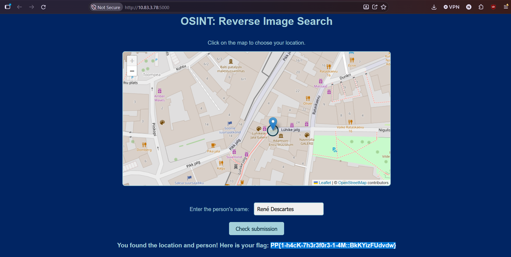

# [Reverse Image Search]

- **CTF Name:** Platypwn 2026
- **Category:** OSINT
- **Writeup Author:** Nakata Christian (n4ct) - TCP1P
- **Date:** November 14, 2026

---

## Challenge Description

> I found some cool street art on the wall next to where this photo was taken. Can you tell me where it was, and who the person portraited on the artwork is?

---

### Step 1: Initial Triage

We're given a photo of a narrow passage between buildings. If we look closely, we can see a banner saying `ART GALLERY TRUUS` on one of the buildings.

Let's continue from here.

### Step 2: Finding the Art

The description said `on the wall next to where this photo was taken`. So I tried to look for the art using photos and videos uploaded by other people (there is no Street View around the gallery). And sadly, there were only 4 photos for this gallery. So I tried to see from another perspective. I looked at the photos and videos from the nearby ice cream store, `Cortile`. Scrolled a bit far and found nothing. When I was just about to give up and look for another way, I found the art! Look at the pole on the right. That is the exact same pole as the one in the original photo.

### Step 3: Who is the Man on the Art?

So if we translate the phrase on the art, it says `I paint. Therefore, I am.`. Sounds familiar? Yes, that is a pun on the famous phrase `I think, therefore I am.` from `René Descartes`. So the man on the art must be him. Pinning the location and entering the name of the man will give us the flag.

Flag: `PP{1-h4cK-7h3r3f0r3-1-4m::BkKYizFUdvdw}`