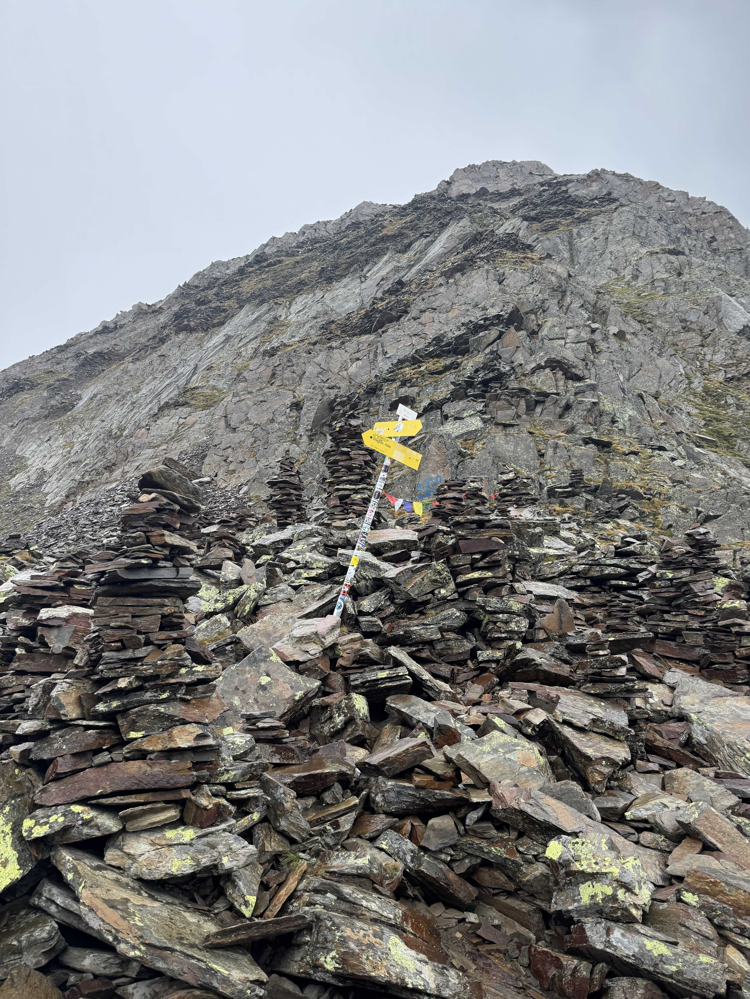
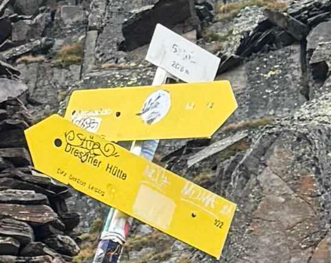
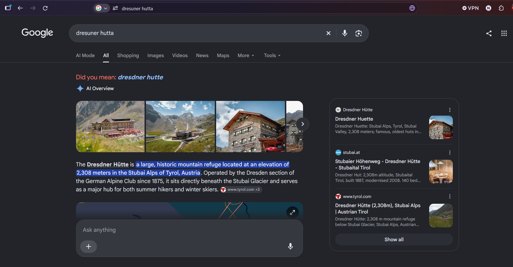
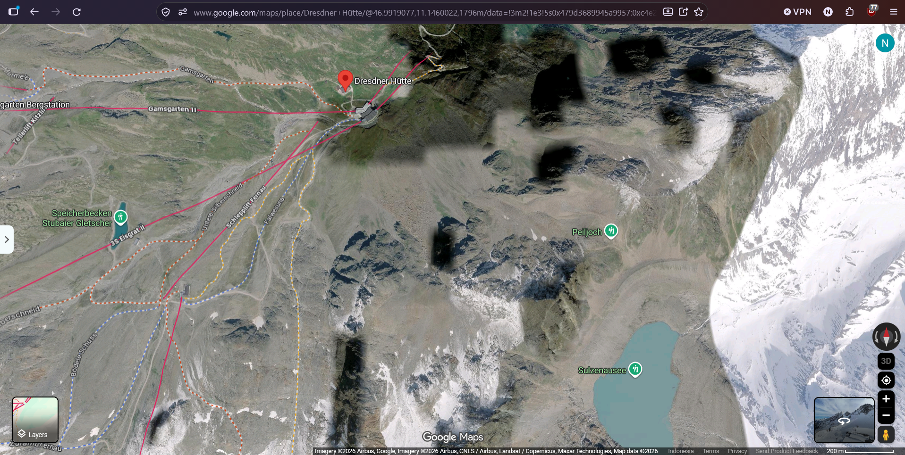
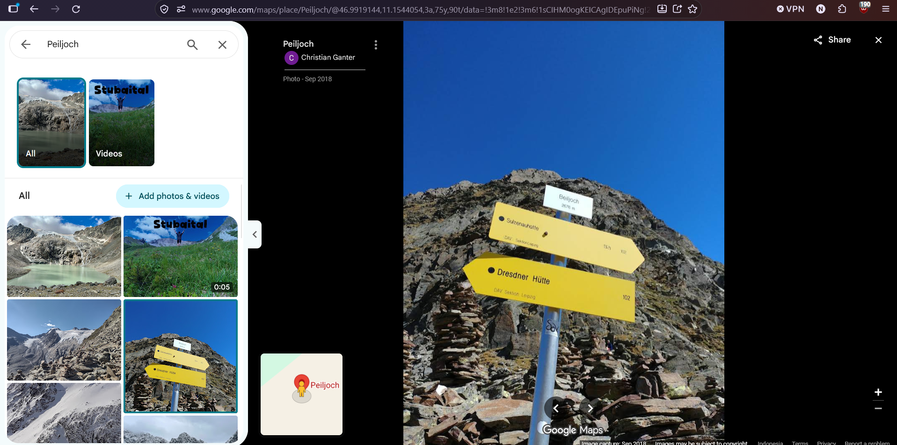
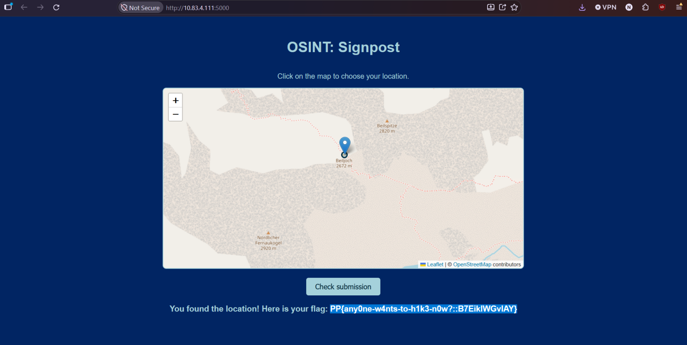

# [Sign Post]

- **CTF Name:** Platypwn 2026
- **Category:** OSINT
- **Writeup Author:** Nakata Christian (n4ct) - TCP1P
- **Date:** November 14, 2026

---

## Challenge Description

> This year's hiking adventure was amazing. Where was this photo taken?
> 
> Brute force is neither necessary nor allowed to solve this challenge. Do not attack the location picker tool. The tool is rate-limited to three tries per minute, so be careful when you submit. A full-resolution version of the image is available for download.

---

### Step 1: Initial Triage

We're given an image of a hill-like place with a sign. Let's see what this sign has for us.

It says `Dresoner Hulla` or `Dresuner Hutta` or something similar. Let's ask Google to correct this for us. If we search for `Dresuner Hutta`, Google will give us `Dresdner Hutte`, a large mountain refuge in Austria operated by the Dresden section of the German Alpine Club since 1875. And guess what? The organizer of Platypwn CTF is a German CTF team. So I think we're on the right track. Let's continue from here.

### Step 2: The Exact Location

If we search for `Dresdner Hutte` on Google Maps and follow the opposite direction of the sign arrow, we'll find `Peiljoch`, a mountain pass in the Stubai Alps, Austria.

And behold, the exact same sign from another hiker!

### Step 3: The Flag

Pinning the location in the location picker from Platypwn will give us the flag.

Flag: `PP{any0ne-w4nts-to-h1k3-n0w?::B7EiklWGvlAY}`